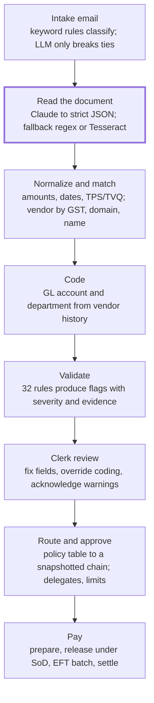
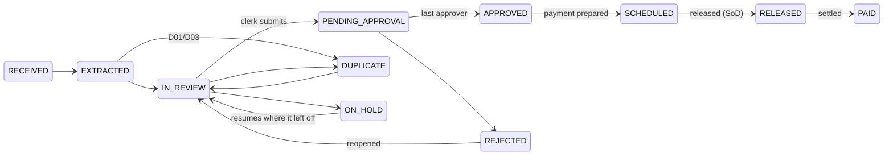

# Brim AP Automation — Technical Design Document

Nov 21, 2026 · Hassan Shah · exported from the team design doc; `docs/decisions.md` has the full reasoning behind every decision.

## Overview

The app takes Harborline Logistics' supplier invoices from the AP inbox to a simulated EFT payment: it reads each document, codes it from history, checks it against 33 rules, routes it to the right approvers from an editable policy table, pays it under segregation-of-duties rules, and logs every step to an append-only, hash-chained audit trail.

**The design principle:** the LLM only *reads* documents. Everything after extraction (validation, duplicates, routing, permissions, payments) is deterministic Java that is unit-tested and explainable. LLM output is treated as untrusted input: it must match a JSON schema, is normalized by Java, and is arithmetic-checked before anyone acts on it.

**Goals it was built against (from the PRD):**

- All 9 required features working end to end before any bonus: intake, extraction, smart coding, validation and matching, duplicates, approval workflow, payments, audit trail, vendor management.
- Hold up on a hidden batch of invoices, which is why the pipeline is rules, not model judgement.
- Every flag explains itself in one sentence with numbers.
- Roles enforced on the server, never only in the UI.

**Status as of this document:** all 9 features and 4 bonuses are built and delivered as 9 stacked pull requests (#1 to #9, none merged). 93 unit tests pass, CI is green, and a scripted check of every case in the PRD's "Mess found" table passes 24/24 on a fresh Docker build. The LLM path has never run live because `LLM_API_KEY` is empty; everything measured so far used the offline readers.

## System architecture

Three containers run under Docker Compose: a React single-page app served by nginx, a Spring Boot API, and PostgreSQL. The only outside service is the Anthropic API, used solely to read documents.

| Component | What it does | Port |
| --- | --- | --- |
| `frontend` | React + TypeScript + Mantine SPA, built by Vite, served by nginx; nginx also proxies `/api` so the session cookie stays same-origin | 5173 |
| `backend` | Spring Boot 3.5 on Java 21: auth, workflow, extraction, rules, routing, payments, audit; runs as non-root user `app` | 8088 |
| `db` | PostgreSQL 16 with a health check; volume `pgdata` | 5432 |
| `storage` volume | Uploaded documents (content-addressed by SHA-256) and the LLM response cache | — |
| `dataset_given/` | Mounted read-only at `/data`: the CSVs, `emails.json` and the 56 incoming invoice files | — |

**Backend packages** mirror the PRD's ownership split: `config`, `auth`, `model`, `repository`, `seed`, `workflow`, `audit`, `approval`, `intake`, `extraction`, `coding`, `validation` (+ `validation/rules`, one class per rule), `duplicates`, `payment`, `vendor`, `bonus`, `admin`, `common`.

**How one invoice moves through the system** is drawn below: from an email or upload to a settled payment, with the deterministic stages after the single LLM call.



*Invoice pipeline: 8 stages, one LLM step (bold). Every step writes to the hash-chained, append-only audit log.*

Only the highlighted step involves the LLM, and its output is schema-checked and normalized before anything downstream sees it.

## Technology stack and system choices

The stack is the team's familiar ECSE 321 stack, chosen so every part can be explained in Q\&A; each library was picked for one specific job.

| Layer | Choice | Why (alternatives rejected) |
| --- | --- | --- |
| Backend framework | Spring Boot 3.5.16, Gradle 9.9.2 | CLAUDE.md pins Boot 3; Initializr only offers 4.x now, so the project was generated there and pinned back (D-001) |
| Language level | Java 21 via `options.release = 21` | Compiles 21 bytecode on any JDK ≥ 21 without a toolchain download; Docker builds on Temurin 21 (D-002) |
| Security | Spring Security, session cookie, `@PreAuthorize` | Gives a clean answer to "how are roles enforced": a filter chain plus per-method checks |
| Persistence | Spring Data JPA, Hibernate `ddl-auto=update` + one idempotent SQL file | Faster to iterate than Flyway in a hackathon; the SQL file adds the audit trigger and id sequences (D-005) |
| Database | PostgreSQL 16 | Triggers (append-only audit), advisory locks (hash chain), sequences, `NUMERIC(14,2)` money |
| LLM | Anthropic Java SDK 3.12.0, model `claude-opus-5-5`, structured outputs | Schema derived from the `ExtractedInvoice` record, so the response must validate; official SDK, not raw HTTP (D-027) |
| PDF text | `pdftotext -raw -enc UTF-8` (poppler) | `-layout` scrambles the totals block; `-raw` keeps each label next to its value and keeps French accents (D-025) |
| OCR fallback | Tesseract 5 (eng + fra in Docker) | Offline path for scans when no LLM is configured |
| CSV / text | Apache Commons CSV, Commons Text (Jaro-Winkler) | Robust CSV quoting; name similarity for vendor matching and lookalikes |
| API docs | springdoc-openapi | `/v3/api-docs` feeds the generated TypeScript types and Swagger UI |
| Frontend | React 19, TypeScript 7, Vite 8, Mantine 8, TanStack Query, React Router | Mantine gives tables, forms, badges and an app shell without a Tailwind setup (D-014) |
| API types | `openapi-typescript` via `npx` | Generated from the live spec; run through `npx` because it needs TypeScript 5 (D-015) |
| Runtime | Docker Compose: postgres, backend (Temurin 21 JRE + poppler + tesseract), nginx | One command for judges; same-origin proxy so no CORS or token storage |
| CI | GitHub Actions | Backend tests, frontend gates, ruff + shellcheck, gitleaks; actions pinned by SHA (D-074) |

**Conventions that hold everywhere:** money is `BigDecimal` / `NUMERIC(14,2)` in the database and a string in JSON (`"4802.50"`), formatted only in the UI (D-024). Dates are ISO `YYYY-MM-DD`. Dataset ids are primary keys (`U003`, `V026`, `AP-00001`), and new rows continue their sequences (`AP-00427`, `PAY-00416`, `V057`, `BC-010`) (D-007). A fixed business date of 2026-11-02, the dataset's as-of date, makes date rules reproducible (D-013).

## Data model

There are 26 tables: 16 map directly onto the dataset's CSVs, and the rest exist because a rule or a guarantee needs them. The count looks large, but each table has one job (this answers the "why so many things in the model" question on PR #1).

| Area | Tables | Modelling decision |
| --- | --- | --- |
| People | `users`, `departments`, `delegations` | Delegation is a time-bounded row, not a user flag; Liam (U012, on leave) becomes an open-ended delegation to Elise (U003) (D-009). Terminated users stay for history. |
| Vendors | `vendors`, `vendor_bank_accounts`, `bank_change_requests` | Bank details are versioned, never edited in place; payments point at a specific version (D-008). |
| Reference | `gl_accounts`, `tax_codes`, `contracts`, `purchase_orders`, `fx_rates` | Tax rates come from the dataset table, never constants. No `po_lines`: the dataset has only PO totals (D-075). |
| Documents | `emails`, `documents`, `extractions` | Files are stored by SHA-256; the raw extraction JSON is kept so "what the model said" can be compared with what the clerk corrected. |
| Bills | `invoices`, `invoice_lines`, `invoice_taxes` | Original currency, CAD equivalent and the FX rate used are stored together. History and new bills share one table (`historical` flag). |
| Checks | `flags`, `flag_dictionary` | One row per finding with severity, message, evidence JSON and who resolved it; never deleted (D-038). |
| Workflow | `approval_policies`, `approval_steps` | Policies are data the Admin edits; the resolved chain is snapshotted per invoice at submit (D-011, D-051). |
| Money out | `payments`, `payment_batches`, `bank_statement_lines`, `card_transactions` | A payment links invoice + bank-account version + releaser. |
| Audit | `audit_events` | Append-only by database trigger, hash-chained (D-006, D-020). |

**Seeding.** `DataSeeder` loads every file in `dataset_given/` on first start and compares counts with the dataset README: 13 policies, 474 approvals, 9 bank changes, 354 statement lines, 590 card transactions, 27 contracts, 8 departments, 306 FX rates, 30 GL accounts, 809 invoice lines, 426 invoices, 415 payments, 52 POs, 6 tax codes, 40 users, 56 vendors, 59 emails and 56 incoming files. All match.

**How the seed shapes the hard cases:**

- Bank history. A vendor with a change gets version 1 (superseded, only the old last 4 digits known) and version 2 (active, from the master). Version 2 is verified only if the change was callback-verified. BC-009 (Cascadia, Oct 27, by email, never verified) is seeded as a pending change that was already written into the master, which is why a naive "invoice matches master" check passes.
- Statuses. History invoices map paid/scheduled/approved/rejected/pending onto the lifecycle enum; payments map settled → SETTLED, outstanding → SENT, scheduled → SCHEDULED (D-010).
- Policies. The 13 English policy sentences are hand-translated once into structured rows (`PolicySeed`), keeping the original sentence in `source_text`.

## Invoice lifecycle and the workflow service

Every invoice state change goes through one class, `InvoiceWorkflowService`, which checks the caller's permission, checks the transition is legal, writes the audit row and saves, all in one database transaction. Controllers never save an invoice directly.

The main path is RECEIVED → EXTRACTED → IN\_REVIEW → PENDING\_APPROVAL → APPROVED → SCHEDULED → RELEASED → PAID, with three side states: ON\_HOLD, REJECTED and DUPLICATE. The legal moves are a table in `InvoiceStateMachine` (unit-tested), drawn below.



*Invoice state machine: 8 main states, 3 side states. ON_HOLD is reachable from any state before RELEASED; REJECTED from intake, review or approval. Full transition table: `InvoiceStateMachine.java`.*

`InvoiceStateMachine` lists every allowed transition, and any other transition is refused. PAID is terminal.

**Operations on the service:**

- `create` puts a new bill in RECEIVED and writes `INVOICE_RECEIVED`; it is the only way a non-historical invoice comes into existence.
- `transition` is the low-level move every operation uses; it rejects illegal moves with a 409 and records before/after snapshots.
- `recordChange` / `recordChangeOnBehalf` audit non-status edits (field corrections, coding changes, delegate approvals).
- `hold` / `releaseHold` park a bill with a reason and return it to exactly where it was (`statusBeforeHold`).

**Rules worth knowing:**

- Exact duplicates (D01, D03) move a fresh bill to DUPLICATE instead of IN\_REVIEW (D-040).
- History rows are read-only for review and approval but may still move along the payment path, because the dataset has 18 scheduled and 2 approved bills waiting to pay (D-023).
- Clerks can edit fields only before submission (RECEIVED, EXTRACTED, IN\_REVIEW, ON\_HOLD, DUPLICATE).
- Every change carries an optimistic-lock version, so two people editing the same bill get a clean 409 instead of a lost update.

## Security and role enforcement

Roles are enforced three times on the server, and every refusal returns 403 (or 401 when not logged in) with a reason that is itself written to the audit log. Hiding a button in the UI is cosmetic.

**Login.** `POST /api/auth/login {userId}` is a demo "log in as any user" switcher with no password (a PRD non-goal). It still issues a real server session: the session id rotates on every switch (session-fixation defence), and every check downstream reads the role from the session, never from the request. Terminated users (U015) cannot log in (D-016).

**The three layers (D-018):**

1. **Filter chain.** `/api/**` requires a session. Writes require a real user principal and are always refused for an Auditor, before any controller runs or any body is parsed. The verification pass found that an anonymous token counts as "authenticated" in Spring, which let anonymous writes reach body validation; that is fixed and pinned by `SecurityConfigTest` (D-071).
2. **Method security.** `@PreAuthorize` on every controller method implements the PRD's role table.
3. **Service checks.** Row scope and segregation of duties: employees see only invoices they requested, approvers their own department plus steps assigned to them or their delegators (D-022), nobody approves their own invoice, nobody releases a payment they approved.

| Role | Code | Hard server-side denials |
| --- | --- | --- |
| Employee | EMP | Approve, pay, read other people's invoices |
| AP Clerk | CLK | Approve, release payments, override BLOCK flags |
| Approver | APR | Release payments, edit bank details, approve above own limit |
| Finance Manager | FM | Release > $100,000 CAD; release anything they approved |
| Controller / Admin | ADM | Approve and release the same invoice |
| Auditor | AUD | Any write (every POST/PUT returns 403) |

**Verified live:** all 57 API operations were probed. As an anonymous caller, 54 of 54 non-public ones return 401. As the Auditor, 28 of 28 writes return 403.

**Other choices:**

- CSRF tokens are off: the API is JSON-only and same-origin behind the proxy, and the cookie is `SameSite=Lax`. Production would turn them back on (D-017).
- Denials are audited in their own transaction so the record survives the rollback of the refused request (D-019).
- The invoice PDF is shown in an iframe, so `X-Frame-Options` is `SAMEORIGIN` rather than `DENY` (D-063).
- The backend container runs as an unprivileged `app` user (D-072); the one native SQL query with a variable uses a bound parameter (D-073).
- Secrets: `LLM_API_KEY` lives only in `.env`, which is git-ignored and has never been committed (gitleaks clean over full history).

## Audit log

The audit log is append-only at the database level and hash-chained, so tampering is both prevented and detectable: a test edit made as database superuser (trigger disabled) was caught by `/api/audit/verify`, which named the exact row.

**What each event records:** sequential id, timestamp (UTC, microseconds), actor, on-behalf-of (delegate actions read "U003 on behalf of U012"), action, entity and id, before and after JSON snapshots, a free-text detail, the previous event's hash and its own hash.

**How the guarantees are built:**

- **Append-only.** A Postgres `BEFORE UPDATE OR DELETE` trigger on `audit_events` raises an exception, so even buggy or malicious code cannot rewrite history (D-006). `TRUNCATE`, used only by the demo reset, does not fire row triggers.
- **Hash chain.** `hash = SHA-256(prevHash | id | ts | actor | onBehalfOf | action | entity | entityId | before | after | detail)`, with `|` and `\` escaped so fields can't be spliced. Any edit changes the row's hash and breaks the link to the next row.
- **Linear under concurrency.** `AuditService` takes a transaction-scoped Postgres advisory lock before reading the last hash and inserting the next row, so parallel writers (the inbox runs 4 workers) cannot fork the chain. Ids are assigned by the chain, so gaps are detectable too (D-020).
- **Atomic with the change.** Normal events join the business transaction (`MANDATORY` propagation): the state change and its audit row commit or roll back together. Denials use a separate transaction so they survive (D-019).
- **Reset is visible.** A demo reset truncates the log and writes `DEMO_RESET` as event 1, so an empty log never looks like a clean one (D-021).

**What is logged:** logins, every invoice transition, field corrections, coding accepted or overridden (with the suggestion it replaced), every validation run, flag acknowledgements and overrides, approvals and rejections (with on-behalf-of), payments prepared, released, batched, settled and failed, vendor onboarding and approval, bank-change requests and verifications, policy edits (before and after), and every access denial with its reason.

**Endpoints (ADM and AUD):** `GET /api/audit` with filters (entity, id, actor including on-behalf-of, action, date range), `GET /api/audit/export.csv`, and `GET /api/audit/verify`, which recomputes the whole chain and reports every break.

## Intake and extraction

This is the only part of the system where an LLM is involved, and its output is handled as untrusted input.

**Email intake.** `emails.json` holds 59 messages. Each one is classified by keyword rules first. The LLM is used only to break a tie, and the email records which method decided (`classifiedBy`). An email with an attachment counts as an invoice unless it is a statement (D-035). Emails that are not invoices go to *Needs attention* with a code and a reason:

- **E01:** "Invoice attached" but nothing is attached.
- **E02:** payment inquiry. It is linked to the invoice it mentions and that invoice's payment status, so EM-057 links to AP-00049, paid on 2026-03-09.
- **E03 / E04:** statements and other non-invoice mail.

Inbox processing is asynchronous because each attachment can mean an LLM call. Four workers run, each under the clicking user's security context, so the audit actor is correct (D-036). A single upload is synchronous.

**Reading a document.** Every file is stored once and keyed by SHA-256, which also powers the D03 same-document check. Text comes from `pdftotext -raw -enc UTF-8`. We use `-raw` rather than `-layout` because `-layout` moves totals onto the row below their label (Cascadia 1625), while `-raw` keeps reading order and French accents (D-025).

**Three-level fallback, never a crash (D-029):**

1. **LLM: Claude via the Anthropic Java SDK with structured outputs.** For a PDF the model gets the PDF itself plus its text layer, with the instruction "copy numbers exactly from here". For a scan it gets the image. It sees layout from the file and exact characters from the text (D-026). The response schema is derived from the `ExtractedInvoice` record, so the response must validate against it. Amounts and dates come back as printed strings (`"1 234,56 $"`): the model transcribes and does not compute (D-027). The default model is `claude-opus-5-5`, overridable with `LLM_MODEL`. Responses are cached by file SHA-256, model and prompt version, so re-runs cost nothing and survive database resets. *Re-extract* bypasses the cache (D-028).
2. **Offline parser.** A label-based regex parser runs over the text layer: pdftotext output, or Tesseract OCR (eng+fra) for images. It repairs OCR-misread tax labels, for example `OST` becomes `QST`, and a bare `ST` at 9.975% is named QST (D-070).
3. **Manual-entry draft.** If both fail, the clerk gets an empty draft with the reason.

Each level records its method in `extractions` and in the audit detail.

**Deterministic normalization (`InvoiceNormalizer`, unit-tested):**

- `1 234,56 $` and `1,234.56` both become BigDecimal 1234.56.
- French and English dates are parsed.
- Tax labels map to the dataset's tax codes: TPS→GST5, TVQ→QST9975, HST, PST.
- Line maths and totals are checked arithmetically.
- Low-confidence fields are highlighted for the clerk.
- Ship-to province comes from Harborline's four office addresses, or from the province code before a postal code (D-034).

**Vendor matching (D-032).** Matching tries the GST number first, then the sender domain, then a fuzzy name match (Jaro-Winkler ≥ 0.93 after removing legal suffixes and treating `&` as `and`). Putting GST first is what resolves the Harlow lookalike to its own record V052 instead of the genuine V026. The lookalike rule then compares the two records. When several vendor records share a domain (V001 and V051 Polar Freight), the closest name wins.

**Enrichment.** Foreign-currency bills are converted at the stored daily rate. Original currency, CAD amount and rate are kept together. Department and requester are inferred from the referenced PO, or else from the vendor's most frequent (department, requester) pair in history. Vendors with no history are left blank and flagged (D-033).

**Measured accuracy.** `scripts/eval_extraction.py` scores all 56 incoming files against ground truth built independently by `build_ground_truth.py` (its own regexes plus hand transcription of the 2 scans). Result: **726/728 fields (99.7%) on the offline path.** Two caveats:

- The offline parser and the ground-truth script both key on these templates' labels, so this overstates offline accuracy on unseen layouts. The LLM path is the answer for those.
- The LLM path has not been run, because no API key was available (D-030).

## Coding suggestions

GL account and department coding is learned from history; there is no LLM here (D-049). For each line, the suggester tries in order:

1. **The vendor's own history, by frequency.** "7 of 8 past invoice lines from X went to 5010."
2. **Similar lines across all vendors**, by token overlap with every past line. "10 of 10 similar past lines went to 5010, e.g. … on AP-00028."
3. **The vendor's default account.**

Every suggestion carries its evidence sentence and a confidence, so the clerk can see why. The clerk can accept or override. An override is kept, audited with the suggestion it replaced, and never touched by later re-coding. Department and requester are inferred the same way (see *Intake and extraction*).

## Validation rules and duplicate detection

**Architecture (D-037).** Each of the 32 catalog rules, plus the bonus rule V06, is its own class: a pure function of an `InvoiceContext`. `InvoiceContextFactory` is the only code that touches the database. It loads the invoice with its lines and taxes, plus:

- reference data: vendors, bank-account versions, bank changes, contracts, the PO and the amount already billed against it, tax codes;
- cross-invoice data: every other invoice, document hashes, card transactions;
- run settings: the business date and the approval thresholds.

That makes each rule trivially unit-testable with a hand-built context. Every rule has a test built on the dataset example the PRD cites.

**A flag** has a rule code, severity (BLOCK / WARN / INFO), a plain-English message with the numbers, evidence, and links to the matched records.

**Flag lifecycle:**

- **Never deleted (D-038).** Re-validation keeps a finding whose code and message are unchanged, along with its acknowledgement or override. It adds new findings and marks OPEN flags that no longer hold as AUTO\_CLEARED. A clerk's fix therefore visibly clears the flag in the history.
- **Who may resolve what (D-039).** A clerk may acknowledge or resolve WARN and INFO flags. Only an FM or Controller may resolve a BLOCK, and only with a note.
- **Holds vs blocks (D-054).**
  - *Payment holds* (V01/V02 vendor not approved, B01/B02 bank not verified) let a bill be submitted and routed, which is how P05 adds the FM step, but stop payment release. They auto-clear when the vendor is approved or the change is verified.
  - Every *other BLOCK* stops submission and approval until an FM resolves it.
  - Submission also requires every WARN to be acknowledged.
- **Exact duplicates (D01/D03)** move the bill to DUPLICATE (D-040).
- **Cross-invoice rules re-run after a batch (D-048).** Workers run in parallel, so a bill can be validated before its duplicate or split partner exists. Without this re-run the Orion split was missed.

**Rule families:**

| Family | Codes | What it checks |
| --- | --- | --- |
| Bank | B01–B04 | Remit-to not verified; unverified recent change; mismatch with the vendor master; duplicate vendor records sharing a bank account |
| Vendor | V01–V06 | Unknown vendor; not approved; inactive; lookalike vendor; lookalike sender domain (V06, bonus) |
| Duplicates | D01–D04 | Same normalized number; near duplicate; same document hash; already paid by Brim card |
| Tax | T01–T03 | Tax vs ship-to province, per tax, from the tax\_codes table; foreign vendors and exempt categories; tax charged without a registration number |
| Contract | K01–K05 | Expired; fixed fee; hourly cap; fuel-surcharge cap; monthly cap |
| Arithmetic and data | X01–X05 | Line maths; totals; missing fields; dates (future, stale); credit notes |
| Purchase order | P13, PO1, P12 | PO required; PO problem; over PO remaining balance (pre-tax) |
| FX | FX1, FX2 | Foreign currency converted; rate fallback |
| Split | S01 | Several bills from one vendor that individually stay under an approval tier but together cross it |

**Duplicate detection in detail:**

- **Invoice-number normalization (D-012):** uppercase, strip non-alphanumerics, strip a generic prefix (INV, FA, …) when digits follow, strip leading zeros. `CN` is *not* stripped, so credit note CN-FA-000413 isn't a duplicate of FA-000413. This is how Brightline "583" matches paid "FA-000583".
- **Duplicate score (D-043),** shown on every D-flag: same vendor 0.30, same normalized number 0.40 (or within 2 characters 0.20), amount within 1% 0.20, dated within 30 days 0.10, identical file 1.0. Credit notes never match invoices.
- **D02 near-duplicate window is 10 days,** and the edit distance must be under half the number's length (D-042).

**False-positive tuning on this dataset.** Each change below was made after a real run, and each is now a unit test.

| Decision | Rule | False positive seen | Fix |
| --- | --- | --- | --- |
| D-041 | S01 | Grouped monthly utility bills with last month's already-paid one | Only group bills still awaiting approval, and only when the group crosses a threshold read from the policy table |
| D-042 | D02 | With the PRD's 30-day window, every monthly subscription matched last month's; Orion 279 vs 281 matched | 10-day window and the edit-distance limit above. It still catches Voyageur "000903-A" vs paid "000903" |
| D-044 | D04 | Every SaaS bill paid by virtual card looked already paid | Ignore AP virtual-card payments of other known invoices; merchant match needs prefix containment or Jaro-Winkler ≥ 0.90 |
| D-045 | V04 | Duplicate vendor records were reported as lookalikes; the genuine Harlow & Stern was blocked | Require a different bank account or email domain (duplicate records are B04); flag only the less-established record, V052 |
| D-046 | T01 | Unregistered suppliers charging no tax were told to charge GST | Computed per tax from tax\_codes by ship-to province, PST on goods lines only; unregistered suppliers aren't told to charge GST |

**Real mess found beyond the PRD's table (D-050):**

- **Contracts:** Polar fuel surcharge 22% vs a 12% cap; Lattice $8,200 vs a $1,320 fixed fee; Redline over its monthly cap.
- **Tax:** Northbound charges ON HST on an AB delivery; Signal & Sparrow charges BC PST on services.
- **Arithmetic and dates:** Northstar prints 24 × $150 as $3,800; Evergreen's total is $100 high; Summit is future-dated.
- **Duplicates and credits:** Fixwell's credit note equals paid FA-000410.

## Approval routing

**Policy as data (D-011).** The 13 English approval rules are translated once into structured rows: a JSON condition tree, the roles to add, and a kind. The kinds are:

- *approval*: tiers, new vendor, Legal;
- *match*: P12, P13;
- *assignment*: P07, P08;
- *payment\_release*: P09–P11.

The original sentence is kept in `source_text`. An Admin edits policies in the UI with a live *preview routing* for any invoice, and every edit is audited with its before and after.

**The router is a pure function (D-051).** `ApprovalRouter` adds the roles of every enabled rule whose condition holds. Roles are unioned and ordered dept\_manager → finance\_manager → controller\_admin → cfo. Each step is then resolved to a person by applying these rules in a loop until nothing changes:

- terminated → their manager;
- on leave → their active delegate, recorded "on behalf of" (P08);
- the requester → their manager (P07, no self-approval);
- already on the chain → their manager (distinct people);
- final step over the person's approval limit → up the manager chain.

Role holders are resolved from data, not hard-coded ids (D-052). The FM is the user with the FM role. The Controller is the Admin who has a manager, the CFO is the Admin without one, and the department manager is `departments.manager_user_id`.

**Routing amount (D-053)** = the larger of the invoice's CAD total and an open S01 split's combined amount (absolute value for credit notes). The chain is **snapshotted** onto the invoice with `routedAmountCad`, so a later policy edit never rewrites history.

**Checks at action time too (D-055).** The person approving must be the step's assignee or someone the assignee delegated to. They may not be the requester, may not have acted on another step, and on the final step must have a limit that covers the amount. A delegate's approval records `actedOnBehalfOf`, which also goes into the audit row. Delegations are rows, which can be time-bounded and created by users (D-009).

**Worked example (PRD, proven on real data).** Queen Street 002935 is $18,758 in Facilities (D07).

1. The department manager Liam (U012) is on leave, so the step goes to Elise (U003) on his behalf.
2. Elise is also the FM, and the FM step can't reuse her, so it escalates to Marcus (U002, Controller).
3. At release, Elise and Marcus are both refused with 403 because they approved. Only Priya (U001, CFO) can release.

`verify_mess_table.py` drives exactly this sequence end to end, to PAID.

**Other routed cases from the batch:**

| Case | Result |
| --- | --- |
| Orion split | 279, 281 and 287 are each under $10k; together $14,543.10, which adds the Finance Manager |
| Unknown or new vendors | Blue Heron, Zephyr and Riverbend get the FM step from P05 |
| Harlow lookalike | Gets the Legal step from P06 |
| Terminated U015 | Never routed and cannot log in |

## Payments

**Path.** A payment moves PREPARED → RELEASED → SENT, through an EFT batch, to SETTLED, and the invoice moves APPROVED → SCHEDULED → RELEASED → PAID. Payments are simulated: there is no real bank connection.

**Prepare (AP clerk).**

- The payment date comes from the vendor's terms.
- Early-payment discounts such as "2/10 net 30" schedule the payment on day 10 with the discount, if day 10 hasn't passed.
- Approved credit notes from the same vendor are netted against the next payment (never below zero) and become PAID when it settles.
- The payment **pins the vendor's current bank-account version.** If the active account changes afterwards, the payment can't be released until it is re-prepared (D-057).

**Release rules (D-056).** `ReleaseRules` is one pure function, used twice: the server refuses with 403 and a reason, and the payments dashboard shows the same reasons on disabled buttons, so the two can never disagree. Release requires all of the following:

- **Release limits** from the policy table (P09/P10): the Finance Manager up to $100k, above that the Controller or CFO.
- **Segregation of duties (P11):** no one who acted on any approval step, either as approver or as the person a delegate acted for. Clerks prepare only.
- **Vendor and bank:** the vendor is active; the pinned bank-account version is verified; there is no pending bank change.
- **Flags:** no open BLOCK flag.

**Batch and settle.** Released payments go into an EFT batch, which marks them SENT. Settling, by hand or by *settle from statement* in reconciliation, marks them SETTLED and the invoice PAID. Historical statuses map as settled → SETTLED, outstanding → SENT and scheduled → SCHEDULED (D-010). Historical approved and scheduled bills can still move along the payment path (D-023).

## Vendor management and bank changes

**Versioned bank accounts (D-008).** A vendor's bank account is never edited in place. Each account is a version: PENDING, ACTIVE, SUPERSEDED or REJECTED, each with a verified flag. On seed, a vendor with a change history gets two versions:

- **v1, SUPERSEDED.** Only the old last four digits are known.
- **v2, ACTIVE.** The full account from the vendor master. It is verified only if the change was callback-verified.

**The Cascadia case.** BC-009 (2026-10-27) was requested by email and never verified, yet the dataset had already applied it to the master (`appliedBeforeVerification = true`). That is exactly why a naive "invoice matches master" check passes. Our B02 flag catches it: both Cascadia invoices, 1624 and 1625, would pay to … 9679, so they are on payment hold.

**Bank change workflow (D-058).**

1. **Request.** A request creates a new PENDING version. The active one is untouched, and the vendor's payments are held.
2. **Verify.** An FM or Admin who is *not* the requester verifies it, and must record a callback. The new version becomes ACTIVE and verified, and the old one is SUPERSEDED.
3. **Reject.** The version becomes REJECTED. If the change had already been applied to the master, as with BC-009, the vendor goes on hold, because no trusted account remains.

**Vendor onboarding (D-059).**

- New vendors start pending review.
- Approval needs a second person: an FM or Admin who did not onboard the vendor.
- Approval also verifies the vendor's initial bank account. It sets `onboardedAt` to the approval date, so P05's "new vendor (90 days)" rule applies.
- Unknown senders (Blue Heron, Zephyr) can be onboarded straight from the invoice screen.

## Frontend

The frontend is React 19 + TypeScript + Vite with Mantine for components (D-014) and TanStack Query for server state. In Docker it is served behind nginx, which proxies `/api`, so the browser never sees the backend port and the session cookie stays same-origin.

**Screens.** Navigation is role-aware, and a demo switcher logs in as any user:

| Screen | Route | Who uses it |
| --- | --- | --- |
| Home | `/` | Everyone: role-specific counts and next actions |
| Inbox | `/inbox` | AP clerk: process the inbox, *Needs attention* list, upload |
| Invoices | `/invoices` | Everyone, scoped; employees see only their own |
| Invoice | `/invoices/:id` | Everyone, with actions by role |
| My approvals | `/approvals` | Approvers and delegates |
| Payments | `/payments` | Clerk prepares; FM, Controller and CFO release, batch, settle |
| Vendors | `/vendors`, `/vendors/:id` | Onboarding, approval, bank changes and verification |
| Policies | `/policies` | Admin: edit the policy table, preview routing |
| Audit | `/audit` | Admin and Auditor: filters, chain verify, CSV export |
| Bonuses | `/fraud`, `/reconciliation`, `/analytics` | See *Bonus features* |

**One shared invoice screen (D-060).** The document is on the left in a same-origin iframe; this is why X-Frame-Options is SAMEORIGIN (D-063). Fields and coding are on the right, and flag cards sit on top. Tabs hold the approval timeline, audit history, related records and the raw extraction.

Actions appear by role. Finance roles see disabled buttons with the server's reason; release blockers come from the same `ReleaseRules` the server enforces. Employees simply don't see actions they can't take. **Hiding a button is cosmetic:** every action is re-checked on the server.

**Conventions:**

- **Types are generated from the backend's OpenAPI spec** (`npm run gen:api` writes `src/api/schema.d.ts`), so the client and API can't drift (D-015, D-061).
- **Money is a string on the wire;** only `lib/format.ts` turns it into "$1,234.56", so JavaScript never does float arithmetic on money (D-024).
- **The same three colours are used everywhere:** red blocks payment, amber needs review, grey is information (D-062). Low-confidence extracted fields are highlighted yellow with "check the document".

## Bonus features

The four bonus features were built in PRD order, and only after all 9 required features passed end to end. Each is deterministic and reuses facts the core already computes.

**Fraud alerts (`/fraud`, D-066).** One view of every payment-fraud signal, sorted by severity and amount:

- open B01–B04, V04–V06 and D04 flags;
- every unverified bank change, with the open bills that would pay to it;
- scheduled payments to vendors whose bank details changed in the last 30 days.

The new rule **V06** flags a sender domain that resembles another vendor's (Jaro-Winkler ≥ 0.88 or containment, ignoring TLD and punctuation). Like V04, it exempts the established vendor writing from its own domain. That false positive showed up on the first batch run and is now a unit test. Currently $19,197.22 of payments are held, led by Cascadia.

**Bank reconciliation (`/reconciliation`, D-067).** A statement debit matches a payment in one of two ways:

- **EFT:** its trailing reference digits equal the end of the payment reference.
- **Cheque:** by amount, within 45 days of the scheduled date, because the dataset's cheque numbers aren't in payment references.

Either way, the amounts must then agree. 332 of 354 lines match. Leftovers are explained as bank fee, money in, a likely payment with its reference missing, or in transit. One PREAUTH DEBIT of $174.90 has no AP record and is flagged to investigate. *Settle from statement* settles SENT payments that the statement shows have left.

**Approval recommendation (D-068).** This is a pure function of open, acknowledged and overridden flags, PO and contract links, and the vendor's paid history. It gives APPROVE, LOOK\_CLOSER or HOLD with a one-line headline and reasons, for example "Approve: within contract C012, vendor paid 10 times before, no open flags". It is shown to approvers above the flags and never approves anything itself.

**Spend analytics (`/analytics`, D-069).** Spend by vendor (totals including tax, in CAD), by department, or by GL account (line amounts converted to CAD) over a date range, with a monthly trend. Only approved, scheduled and paid bills count. Approvers see only their own department, and the server enforces that.

## Testing and verification

**Unit tests (93, `./gradlew test`).** They cover:

- every validation rule, each on its PRD dataset example;
- the router, including the worked example, and ReleaseRules;
- the normalizer: French amounts, tax labels, OCR repairs;
- the audit hash chain;
- security, including `SecurityConfigTest`, which first failed with "expected 401 but was 400" before the D-071 fix.

Rules are pure functions over a hand-built context, so the tests need no database.

**The PRD's "Mess found" table as an executable check (D-064).** `scripts/verify_mess_table.py --process` resets the database, processes all 59 emails, asserts every row of the table, drives the worked example to PAID (approvers refused at release with 403), and verifies the audit chain. Result: **24/24**, locally and on a fresh `docker compose up --build`.

**Other checks run in the pre-review pass:**

| Check | Result |
| --- | --- |
| Every phase branch builds and passes its own tests | 4 → 10 → 24 → 67 → 81 → 81 → 81 → 88 → 93 |
| Extraction eval, 56 files | 726/728 fields (99.7%), offline path |
| PRD API contract | All 44 endpoints present (57 operations live) |
| Live role probe | 54/54 non-public operations → 401 when anonymous; 28/28 writes → 403 as Auditor |
| Frontend | `tsc -b` clean; oxlint 0 errors (4 accepted warnings, D-076); build OK; `npm audit` 0 vulnerabilities |
| Secrets | gitleaks clean over full history and working tree; `.env` never committed |
| SAST | semgrep (java, security-audit, secrets, typescript, dockerfile) clean after 2 fixes |
| Scripts | ruff and shellcheck clean; `build_ground_truth.py` regenerates byte-identical output |

**Findings fixed in the verification pass:**

| Severity | Finding | Fix |
| --- | --- | --- |
| High | Anonymous writes got 400 instead of 401. They passed the filter chain because anonymous counts as authenticated in Spring, and were stopped only by `@PreAuthorize` | Filter rule requires a real `CurrentUser` (D-071) |
| Medium | Backend container ran as root | Non-root `app` user (D-072) |
| Medium | No CI | GitHub Actions (D-074) |
| Low | SQL string concatenation in `IdGenerator` | Bound parameter (D-073) |
| Low | ruff findings in scripts | Fixed |

**CI (`.github/workflows/ci.yml`).** It runs on every PR and on main:

- backend unit tests on Java 21;
- frontend typecheck, lint, build and `npm audit` (high and above);
- ruff and shellcheck on scripts;
- gitleaks over full history.

Actions are pinned by commit SHA and images by digest, with `permissions: contents: read`. PRs #1–#8 show no checks because a PR runs only the workflow on its own head branch.

## Running and operating

**Start:**

```bash
cp .env.example .env     # LLM_API_KEY optional; without it the offline path is used
docker compose up --build
# app http://localhost:5173 · API http://localhost:8088/api · Swagger /swagger-ui.html
```

Compose runs three services: Postgres, the backend (Temurin 21, non-root, with pdftotext and Tesseract eng+fra), and the frontend (nginx proxying `/api`). The dataset is mounted read-only at `/data` (D-004). Documents and the LLM cache live in a named `/storage` volume. If you ran an older root-user image, run `docker compose down -v` once (D-072).

**Configuration (environment variables):**

| Variable | Default | Purpose |
| --- | --- | --- |
| `LLM_API_KEY` | empty | Enables Claude extraction; never committed |
| `LLM_MODEL` | `claude-opus-5-5` | Extraction model |
| `BUSINESS_DATE` | `2026-11-02` | Fixes "today" for date rules so the demo behaves the same any day; empty = the real date (D-013) |
| `APP_DATA_DIR` | `/data` | Dataset location |
| `SERVER_PORT` | `8088` | Backend port; 8080 was taken on the dev machine (D-003) |

**Schema.** Hibernate `ddl-auto=update`, plus the idempotent `db/after-ddl.sql` for what JPA can't express: the audit trigger and the id sequences (D-005). Dataset ids are the primary keys; new rows continue the sequences, for example AP-00427, PAY-00416, V057 (D-007).

**Scripts:**

- `scripts/reset-and-seed.sh` (or `.ps1`): wipe and reload in about 6 s, then print row counts against the dataset README. This is backed by `POST /api/admin/reset`, which is admin only and restarts the audit chain with `DEMO_RESET`.
- `python scripts/verify_mess_table.py --process`: the 24-check acceptance run.
- `python scripts/eval_extraction.py`: extraction accuracy over all 56 files.
- `python scripts/flag_report.py`: every open flag on every bill.
- `cd backend && ./gradlew test`: unit tests.

**Demo logins** (no password; the server still issues a real session):

| User | Id | Role |
| --- | --- | --- |
| Jordan Okafor | U004 | AP Clerk |
| Elise Tremblay | U003 | Finance Manager; delegate for Liam |
| Marcus Webb | U002 | Controller |
| Priya Raman | U001 | CFO |
| Dev Malhotra | U007 | Approver (Operations) |
| Hannah Lindqvist | U006 | Auditor |
| Kavya Morrison | U037 | Employee |

API documentation is available at `/swagger-ui.html`.

## Design decisions index

The full reasoning and the alternatives considered are in `docs/decisions.md` (D-001 to D-080). This index groups the decisions by theme.

| Theme | Decisions | Gist |
| --- | --- | --- |
| Platform and build | D-001–D-005, D-014, D-015 | Boot 3.5.16 pinned (Initializr only offers 4.x); `--release 21` rather than a toolchain; port 8088; dataset read in place; `ddl-auto` + `after-ddl.sql` rather than Flyway; Mantine; OpenAPI types via `npx` |
| Data and seeding | D-007–D-010, D-012, D-013, D-075 | Dataset ids as PKs plus sequences; versioned bank accounts from history (BC-009 seeded as pending-but-applied); delegations as rows; status mapping; credit-note-safe number normalization; fixed business date; no `po_lines` (header-level PO matching) |
| Audit | D-006, D-019–D-021 | DB trigger makes the log append-only; denials in their own transaction; advisory-locked hash chain; reset writes `DEMO_RESET` |
| Security | D-016–D-018, D-022, D-071–D-073 | Real server session from the demo login; CSRF off (JSON, same-origin, SameSite=Lax); three enforcement layers; approver scope includes delegated steps; anonymous writes 401 at the filter; non-root container; bound SQL parameter |
| Money | D-024 | BigDecimal / NUMERIC(14,2), serialized as strings; original currency, CAD and rate stored together |
| Extraction | D-025–D-036, D-070 | `pdftotext -raw`; LLM sees the file and the text layer; structured outputs, amounts as printed, deterministic normalizer; cache by SHA-256; three-level fallback; independent ground truth; vendor match GST → domain → name; inferred department; keyword-first classification; 4 async workers; OCR label repair |
| Validation | D-037–D-050 | One pure class per rule; flags never deleted; resolution rights by severity; DUPLICATE status; tuning of S01/D02/D04/V04/T01; duplicate score; batch re-validation; coding from history; extra mess found |
| Approvals and payments | D-051–D-059, D-065 | Pure router over the policy table; role holders from data; routing amount includes splits; holds vs blocks; action-time approver checks; one `ReleaseRules` for server and UI; pinned bank version, discounts, credit netting; two-person bank changes and vendor approvals; missing department surfaced, not guessed |
| Frontend | D-060–D-063, D-076 | One shared invoice screen; generated types; three-colour severity; SAMEORIGIN framing for PDFs; 4 accepted lint warnings |
| Verification and bonuses | D-064, D-066–D-069, D-074 | Mess table as an executable check; fraud view plus V06; deterministic reconciliation; recommendation; analytics; pinned, least-privilege CI |
| Team review | D-077–D-080 | FM or Controller releases up to $100k (PRD over the dataset's P09); invoices over $250k have no eligible releaser, by design; B01/B02 hold payment, not approval; Windows reset bypasses script policy for one run |

**The few decisions that shape everything:**

1. **The LLM only reads documents.** It returns printed strings under a schema; Java decides everything else.
2. **One workflow service** owns every invoice state change and writes the audit row in the same transaction.
3. **Rules, routing and release are pure functions over data.** They are testable and explainable, and the UI shows the same reasons the server enforces.
4. **Nothing security-relevant is edited in place.** This applies to bank accounts, approval chains, flags and the audit log alike: changes are new versions, snapshots or appended rows.

## Limitations, open items and scaling

**Not verified:**

- **The LLM extraction path has never run live,** because `LLM_API_KEY` was empty throughout. To check it, add a key to `.env`, restart, and run `python scripts/eval_extraction.py`. The offline 99.7% overstates accuracy on unseen layouts (D-030).
- **There are no end-to-end browser tests.** The UI was checked by hand as AP Clerk, Finance Manager and Auditor.

**Process items:**

- **Nothing is merged yet.** PRs #1–#9 are stacked, so merge them in order. Branch protection on `main` isn't configured.
- Docker builds fetch from Maven Central, and on a flaky network the first attempt can fail. Re-run if it does.

**Accepted shortcuts for a hackathon, and what production would do instead:**

| Shortcut | Production |
| --- | --- |
| Passwordless demo login | Real identity provider (SSO) |
| CSRF off | CSRF tokens back on |
| Hibernate `ddl-auto` | Flyway migrations |
| Header-level PO matching | Line-level 3-way match once PO lines exist (D-075) |
| Simulated EFT and bank | A real payment rail and statement feed |

**Scaling to 100× (about 5,000 invoices a month):**

| Bottleneck today | Change |
| --- | --- |
| Synchronous LLM calls in the request path | A job queue with retries and per-file idempotency; the SHA-256 cache already makes re-reads free |
| Duplicate search scans every invoice | Index on (vendor, normalized number) plus an amount-bucket blocking key |
| The context factory loads all vendors and invoices per bill | Cache reference data; query only the vendor's time window |
| One ever-growing audit table | Partition by month; verify the chain per partition from an anchored head hash |
| LLM cost and rate limits | Batch API for the inbox, caching by file hash, a smaller model for classification |
